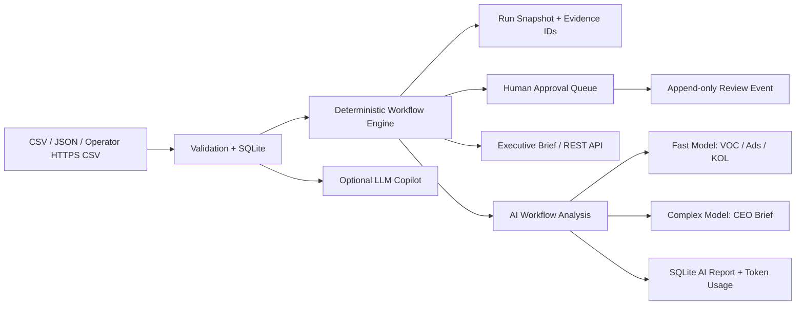

# Architecture

**Input**: real user-supplied CSV/JSON. Default database is empty. Sample data only with `AGENTOPS_SEED_SAMPLE=1`.

**DTC/VOC**: transparent multilingual keyword groups, rating-dependent priorities. Not an ML classifier or verified defect detection.

**Ads**: ROAS=attributed revenue/spend, CPA=spend/conversions, CTR=clicks/impressions, CVR=conversions/clicks. No causal incremental-ROAS claim.

**KOL**: a disclosed weighted screening score, not fraud detection or predictive sales forecasting.

**Idempotency**: SHA-256 snapshot of selected normalized input tables + algorithm version. Same snapshot/workflow reuses the last run unless `force=true`. SQLite is single-writer, best suited to one-operator use.

**Human review**: recommendation records are created only on new analyses. Approvals store a time-stamped event. Approval does not call external marketing APIs.

**Dual-model inference**: one API Key and Base URL, two independently configurable model IDs. VOC / Ads / KOL use the fast route by default; CEO Brief uses the complex route. Deterministic metric calculations remain authoritative; the LLM adds interpretation and recommendations. AI workflow analysis requires explicit external-processing consent and sends only aggregate metrics, limited business fields and evidence IDs; raw VOC comments are excluded. Reports and token usage are persisted locally. The Copilot endpoint remains an optional LLM path. No claim of vector RAG, autonomous tool execution or guaranteed answer correctness.

**Scale boundary**: missing organization accounts, roles, OAuth, queues, streaming, rate limiting and cross-user isolation. Do not deploy to public internet without adding these controls.
